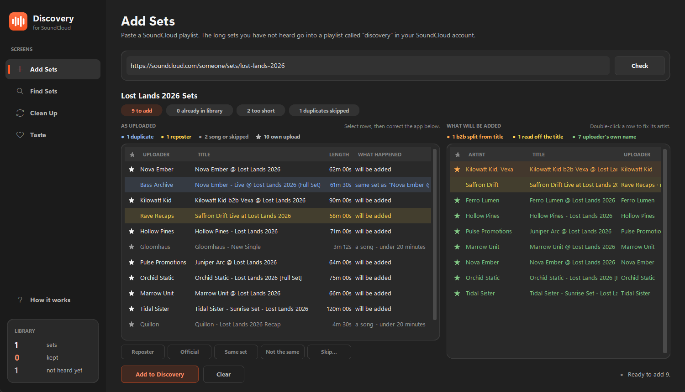
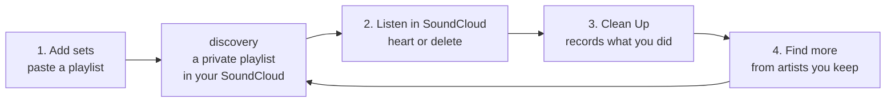
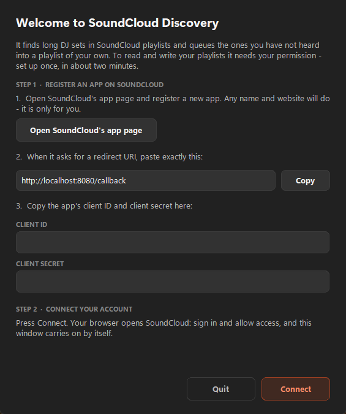
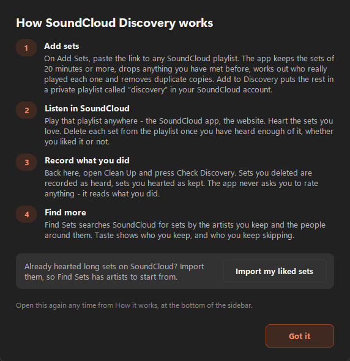

# SoundCloud Discovery

A desktop app for people who listen to DJ sets on SoundCloud. Paste any
playlist and it pulls out the long sets you have not heard yet, works out who
actually played each one, throws away duplicate uploads, and queues the rest
into a private playlist in your SoundCloud account. Then you listen as you
normally would — and it learns what you liked from what you did.



---

## Why it exists

Festival and mix playlists on SoundCloud are a mess to work through:

- **Songs mixed in with sets.** A "Lost Lands 2026" playlist is half
  three-minute tracks.
- **The same set, five times.** The artist uploads it, the festival uploads
  it, three fan accounts rip the livestream.
- **The wrong name on it.** A set posted by *Festival Rips HQ* is credited to
  Festival Rips HQ, not to the DJ who played it.
- **No memory.** Next month's playlist queues the set you already heard and
  skipped.

SoundCloud Discovery handles all four. It never plays audio, and it never asks
you to rate anything.

---

## How it works



1. **Add sets.** Paste a SoundCloud playlist link. The app keeps the sets of
   20 minutes or more, drops anything you have met before, works out the real
   performer and removes duplicate copies. What is left goes into a private
   playlist called **discovery** in your SoundCloud account.
2. **Listen in SoundCloud** — on your phone, on the website, anywhere.
   **Heart** the sets you love. **Delete** each set from the playlist when you
   are done with it, liked or not.
3. **Clean Up.** Back in the app, press **Check Discovery**. Every set you
   deleted is recorded as heard; every set you hearted as kept.
4. **Find more.** Once you have kept a few, **Find Sets** searches SoundCloud
   for more by those artists and the people around them, and **Taste** shows
   who you keep — and who you keep skipping.

Everything you have heard, liked or turned down is remembered, so nothing is
ever queued twice.

---

## Getting started

### What you need

- **Windows 10 or 11.** The app is Python and Tk, so it may run elsewhere, but
  it has only been used on Windows.
- **Python 3.12 or newer** from [python.org](https://www.python.org/downloads/).
  In the installer, tick **Add python.exe to PATH**.
- **A SoundCloud account.**

### 1. Download

Click **Code → Download ZIP** on GitHub and unzip it somewhere permanent (your
library lives in this folder), or clone it:

```bash
git clone <this repository's URL>
```

### 2. Double-click `run.bat`

The first time, it sets itself up: it creates a private Python environment in
a `.venv` folder and installs the two libraries the app needs. That takes about
a minute and needs an internet connection. After that, `run.bat` just starts
the app.

### 3. Connect to SoundCloud

On first launch a setup window walks you through this:



SoundCloud lets personal tools into your account through an "app" that you
register yourself. It is free, takes a minute, and only you use it.

1. Press **Open SoundCloud's app page** (it opens
   <https://soundcloud.com/you/apps>) and register a new app. Any name and
   website will do.
2. When SoundCloud asks for a **redirect URI**, paste exactly
   `http://localhost:8080/callback` — the **Copy** button puts it on your
   clipboard.
3. Copy the app's **client ID** and **client secret** into the two boxes.
4. Press **Connect**. Your browser opens SoundCloud; sign in and allow access.
   The app carries on by itself.

You only do this once. The details are saved in `config.json` in the app's
folder and never leave your computer. If SoundCloud's page looks different
from these steps, its [developer guide](https://developers.soundcloud.com/docs/api/guide)
describes the current process.

### 4. Your first session

When the main window opens, a short guide explains the loop. You can open it
again any time from **How it works** at the bottom of the sidebar.



1. **Already have liked sets on SoundCloud?** Press **Import my liked sets** in
   the guide (or **Import liked sets** on the Clean Up screen). They are saved
   as heard and kept, so Find Sets has artists to start from straight away.
   Nothing is added to your playlist.
2. **Add Sets** → paste the link to any SoundCloud playlist
   (`https://soundcloud.com/<someone>/sets/<name>`) → **Check**. Look over the
   result, then press **Add to Discovery**.
3. Open SoundCloud → **Library → Playlists → discovery**. Listen. Heart what you
   love; delete what you are done with.
4. Back in the app: **Clean Up → Check Discovery**.

That is the whole routine. Repeat steps 2–4 whenever you like.

---

## The screens

### Add Sets

Paste a playlist link and press **Check**. Nothing is added until you press
**Add to Discovery**, and the app never stops to ask you a question while it
works — it decides, then shows you what it decided.

The result appears twice, side by side.

**Left — the playlist as uploaded**, every track, highlighted by what happened
to it:

| highlight | means |
|---|---|
| red | already in your library |
| blue | a duplicate — *What happened* says of which track, and which copy was kept |
| yellow | posted by a known reposter, so the artist was read from the title |
| grey | a song under 20 minutes, or a set you turned down before |

**★** marks an upload from the performer's own account.

**Right — what will be added**, exactly as it will be stored, coloured by how
the artist was worked out. Read the warmer colours first; they are sorted to
the top:

| colour | how the artist was worked out | how far to trust it |
|---|---|---|
| green | the account that posted it is the artist; nothing was guessed | usually right — but see below |
| amber | a repost account posted it, so the name was cut out of the title | check it |
| orange | the title looked like a b2b and was split into several performers | check it closely |
| red | the title could not be read at all | always needs fixing |

> **Green means the app did not guess — not that the name is right.** A
> festival or fan account the app has not met yet looks exactly like an artist
> posting their own set. In the screenshot above, *Pulse Promotions* is green
> but really posted a Juniper Arc set. That is what the **Reposter** button is
> for.

**Fixing what it got wrong.** Select rows on the left, then:

- **Reposter** — this account posts other people's sets. Its sets are re-read
  from their titles. Remembered for every future playlist; press again to undo.
- **Official** — this account belongs to the performer even though its name
  does not say so (a duo's shared account, say). Remembered too.
- **Same set** — these rows are copies of one recording that the app missed.
  The best copy is kept: the performer's own upload, then one you liked, then
  the longest.
- **Not the same** — on a blue row the app got wrong. Both are kept, and that
  pair is never matched again.
- **Skip…** — leave a set out, with a reason. It is never offered again.

**Double-click a row on the right** to type the correct artist (comma-separate
a b2b). Your correction is permanent. Tick **Always read "…" as this** to apply
it to every future playlist — worth it for a duo's shared name.

### Find Sets

Searches SoundCloud for you, starting from the artists you keep. Choose where
to look on the left, then press **Search**:

| source | what it reads |
|---|---|
| Your kept artists | their uploads you have not heard, best keepers first |
| Accounts you follow | recent uploads from everyone you follow |
| Their circle | what your top artists like, and accounts several of them follow |
| Similar sets | SoundCloud's related tracks for sets you kept recently |
| Your genres | long sets in the genres you keep most — mostly new artists |

The filters below them:

- **Artist already in your library** — set it to **Never** to hear only
  artists you have never met. In a b2b, one new performer is enough.
- **Search depth** — Quick, Normal or Deep. Deep finds more and takes about
  twice as long; a normal search takes about a minute. **Stop** keeps whatever
  it has found so far.

Results run through the same checks as Add Sets and are coloured the same way.
**Found because** says why each one turned up, and **Left out** says what the
filters removed, so an empty search explains itself.

To review the queue: **double-click** a row to fix its artist; select rows and
press **Remove…** (or Delete) to turn them down with a reason. Every reason is
remembered, and **Not into this artist** also leaves that artist out of later
searches. **Not now** removes a set from this queue without remembering
anything. When the queue looks right, **Add to Discovery**.

### Clean Up

- **Check Discovery** — run this after a listening session. It reads your
  SoundCloud likes and compares the playlist with last time: sets you deleted
  are recorded as heard, sets you hearted as kept. You do *not* need to run it
  before listening.
- **Remove liked from Discovery** — optional tidying. Takes the sets you
  hearted out of the playlist; they stay in your library and your likes.
- **Import liked sets** — brings in long sets you hearted on SoundCloud without
  going through the app, so they count toward your taste and are never queued
  back at you. Worth running now and then.

### Taste

Two lists: artists you have kept something from, and artists you have heard
four or more times without keeping anything. The second list is the useful
one — those are artists worth leaving out of searches.

---

## Fixing things the app cannot fix on screen

A few rarer corrections live in a small command-line tool. Open a terminal in
the app's folder and run:

```bash
.venv\Scripts\python.exe scripts\manage.py <command>
```

| command | when to use it |
|---|---|
| `stats` | a quick health check: sets, keep rate, last check |
| `flagged` | list every stored set whose artist the app was unsure of |
| `fix <track id> "Artist"` | correct one stored set's artist (`flagged` prints the id) |
| `repost "Account"` | mark an account as a reposter, outside the Add screen |
| `alias "TapeB" "Tape B"` | one artist appears under two spellings |
| `event "Festival Name"` | a festival's name keeps ending up as the artist |
| `place miami` | sets from two different cities or stages were merged as one |
| `import-likes` | the same as **Import liked sets**; add `--apply` to write |

A new library starts with a list of about 60 well-known festival names and
common city and stage names; `event` and `place` add to them.

---

## Troubleshooting

**`run.bat` says Python was not found.** Install Python 3.12 or newer from
[python.org](https://www.python.org/downloads/) with **Add python.exe to
PATH** ticked, then double-click `run.bat` again.

**"Port 8080 is already in use".** Another program is using the port the
sign-in page returns to. Close it (often a local web server) and press Connect
again.

**"SoundCloud did not approve access".** The redirect URI on your SoundCloud
app must be exactly `http://localhost:8080/callback` — no trailing slash, `http`
not `https`.

**"SoundCloud did not accept the client ID and secret".** Copy both again from
your app's page. To start over, delete `config.json` and restart the app.

**"SoundCloud has signed this app out".** Close and reopen the app; it will ask
you to connect again.

**A check finds nothing to add.** The pills under the playlist name say why —
usually "too short" (the playlist is songs, not sets) or "already in library".

**An artist shows up as a festival or channel name.** Select its row on Add
Sets and press **Reposter**. If it is already stored, use `manage.py fix`.

**The app does not open at all.** Look for `crash.log` in the app's folder; it
says what went wrong.

**Do not rename or delete the discovery playlist.** The app finds it by name.
Without it, the app makes a new, empty one — and the next Check Discovery
records every set that was waiting in the old one as heard.

---

## Your data

Everything stays on your computer, in the app's folder:

| file | holds |
|---|---|
| `discovery.db` | your library: every set, what you kept, what you heard |
| `config.json` | your SoundCloud app details and sign-in |

The app talks to SoundCloud and nothing else. In your SoundCloud account it
only ever creates and edits its own private **discovery** playlist; everything
else it only reads.

**Back up `discovery.db` now and then** — copy it anywhere safe. It cannot be
rebuilt: the record of what you heard exists only in the difference between
what was in the playlist last time and what is there now. Both files are listed
in `.gitignore`, so they are never committed if you work on the code.

---

## For developers

```bash
.venv\Scripts\python.exe -m pip install pytest
.venv\Scripts\python.exe -m pytest tests/ -q
```

About 570 tests, a few seconds, no network. They never touch your
`discovery.db`.

Start with **[AGENTS.md](AGENTS.md)**: the rules, a map of every file, and
which file to open for which kind of change.
[docs/DOMAIN.md](docs/DOMAIN.md) explains the artist and duplicate rules and
the measurements behind them; [docs/DECISIONS.md](docs/DECISIONS.md) explains
choices that look wrong but are deliberate.

```
src/core/      pure rules: artist resolution, duplicates, ranking
src/data/      the SQLite library
src/api/       SoundCloud sign-in and API calls
src/services/  the Add, Find, Clean Up and import pipelines
src/ui/        the window
scripts/       manage.py, and the golden-test generators
tests/         pytest; tests/golden/ holds the frozen fixtures
```
